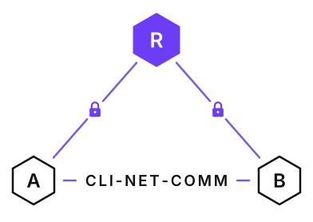
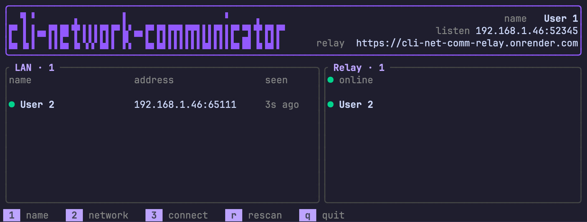

<p align="center">
  <a href="https://www.rust-lang.org/"></a>
  <a href="https://github.com/rustls/rustls"></a>
  <a href="https://cli-net-comm-relay.onrender.com"></a>
  <a href="https://render.com"></a>
  <a href="LICENSE"></a>
  <a href="https://github.com/SimonVesely/cli-net-comm/commits/master"></a>
</p>

<p align="center">
  <picture>
    <source media="(prefers-color-scheme: dark)" srcset="relay/assets/logo-dark.svg">
    
  </picture>
</p>


# Secure LAN/Internet CLI Communicator

A secure command-line interface (CLI) application written in **Rust** for encrypted text-based communication between two users. It supports direct peer-to-peer connection over a local network (LAN) and mediated communication via a remote relay server (Axum) over the Internet.

## Features

* **End-to-End Encryption:** Secure communication built with Rust's memory safety and performance in mind.
* **Dual Connection Modes:**
  * **LAN:** Direct peer-to-peer (P2P) connection without requiring an external server.
  * **Internet:** Relay communication facilitated via a central server built with Axum.
* **Lightweight CLI Interface:** Fast, responsive, and easy-to-use terminal-based navigation.

---

## Terminal User Interface made with RataTUI
<p align="center">
  
</p>

---

## Architecture

1. **CLI Client (Rust + Ratatui):** User application for encrypting, sending, receiving, and decrypting messages.
2. **Server (Rust + Axum):** Central relay node facilitating message transfer when peers are behind NATs or on separate networks.

---

## Getting Started

### Prerequisites
* [Rust & Cargo](https://www.rust-lang.org/) installed on your machine.
* Strongly recommend using a [Nerd Font](https://www.nerdfonts.com/font-downloads) — the TUI relies on special icons and characters that won't render properly without one.

### 1. Clone the Repository
```bash
git clone https://github.com/SimonVesely/cli-net-comm
cd cli-net-comm
```

### 2. Run CLI Client application using Cargo
```bash
cargo run --release
```
